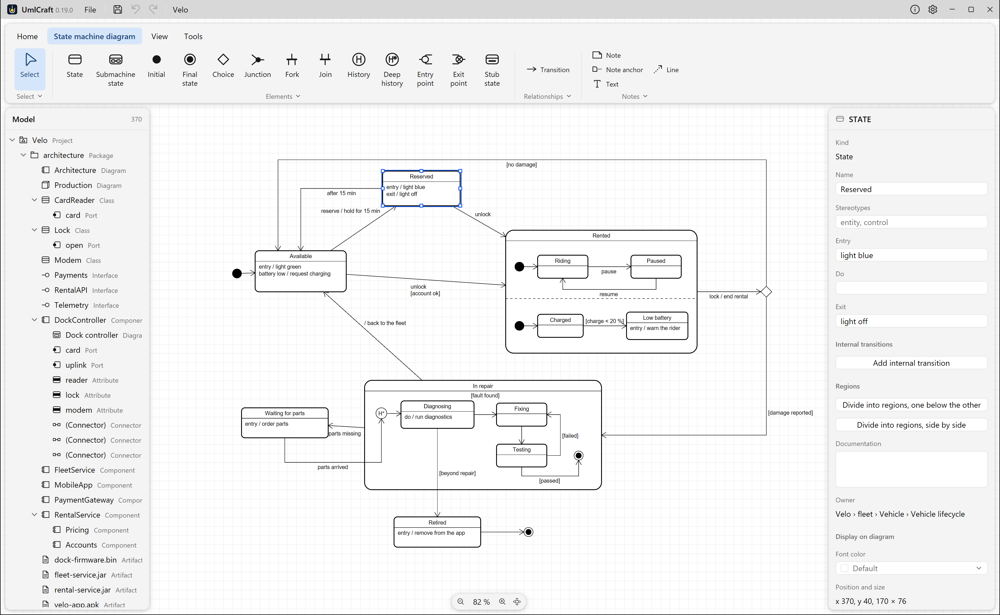

# UmlCraft

A UML modeling tool written in Rust with [GPUI](https://gpui.rs), built from scratch. It opens
and writes `.asta` project files and imports Java, C#, C++ and Python source code.



## Download

Releases for Windows (x64: installer and `.zip`), macOS (universal) and Linux (x64: `.deb`,
`.rpm`, AppImage, Flatpak, Snap and `.tar.gz`) are on the
[releases page](https://github.com/udvlp/UmlCraft/releases).
The builds are not signed yet; the release notes explain how to start them anyway. What changed
between releases is in the [changelog](CHANGELOG.md).

## Diagrams

| Diagram | What it covers |
| --- | --- |
| Class | Classes, interfaces (also as a circle), enumerations, packages and subsystems; attributes, operations and template parameters with bounds and defaults; associations with roles, multiplicities, navigability, aggregation, qualifiers and static ends; generalization, realization, dependency; containment lines (⊕) to nested classes; bound templates such as `Box<Holder, 20>`, also drawn as bound classes with their «bind» line |
| Object | Objects `name : Class` with a slot for every attribute of the class, inherited ones included; links with roles, navigability and aggregation, as instances of associations. They are drawn on class diagrams; an object diagram is a class diagram whose ribbon starts with Object and Link |
| Use case | Actors, use cases with extension points, system boundary, include and extend with condition, notes on lines |
| Sequence | Lifelines, synchronous, asynchronous, reply, create (the new lifeline with a bar for its constructor), destroy, self, found and lost messages (one click on the lifeline; drag the dot to change length and side; lost ones start as replies), activation bars (a caller's lasts as long as its call), message numbers, combined fragments (alt, opt, loop, par, …) with operands and guards, interaction uses |
| Activity | Actions, initial and final nodes, decision, merge, fork and join, object nodes (also in a state, `Order [filled]`), flows with guards, partitions (also nested) |
| State machine | States with entry, do, exit and internal transitions, composite states, orthogonal states with regions one below the other or side by side, final states, initial, choice, junction, fork, join and history pseudostates, transitions labeled `trigger [guard] / effect`. A state dragged into another state or region becomes part of it |
| Component and deployment | Components, artifacts and nodes with their icons, objects and instances, deployments |

Diagrams imported from `.asta` files keep their layout, sizes and colors. The properties panel
sets per class box what it shows of its members (stereotypes, visibility, types, initial
values, parameters and their directions, the members of chosen visibilities), and per box or
line the color of its name and of the line.

## Files

- **Open `.asta` files** (File › Import .asta project, or simply open the file): Astah project
  files with the model, all diagram kinds above, positions, sizes, waypoints, line styles, notes,
  free texts and lines, and colors. Anything UmlCraft cannot represent yet is skipped and reported.
- **Export to `.asta`** (File › Export › .asta project …): writes `.asta` files through the
  official API of an installed Astah; without one the menu item explains what is missing. What
  the API cannot express is reported. See
  [docs/architecture.md](docs/architecture.md#asta-export).
- **Images** (File › Export › Diagram as SVG … / Diagram as PNG …): the open diagram. SVG keeps
  real text; PNG is rasterized at twice the canvas size. Edit › Copy diagram as image
  (Ctrl+Shift+C) puts both on the clipboard: Word and PowerPoint paste the SVG as a vector
  image, other programs the PNG.
- **Structograms** (File › New structogram, Import › Structogram (.nsd) …, Export ›
  Structogram as .nsd …, and the source import): Nassi-Shneiderman diagrams as
  [Structorizer](https://structorizer.fisch.lu) draws them are part of the project and saved in
  the `.ucraft` file with the UML diagrams. They open in the main window like a diagram, drawn
  line for line as Structorizer draws them (syntax highlighting off), and export as SVG or PNG.
  They are edited as in Structorizer, from the ribbon's Structogram tab: insert elements before
  or after the selection, edit text and comment in a dialog, cut, copy, paste, drag, colour,
  disable and delete them, add and remove branches; undo and redo share one history with the
  diagrams. Structorizer's `.nsd` files (3.32-35) are imported and exported with their content
  and changed parser keywords; opening one starts a new project with it. Methods of Java, C#,
  Python or C++ files become structograms without types, with assignments as `x := 42 + a`,
  conditions as `a > 0?` and returns as `return x`; what has no place in a structogram
  (`continue`, labels …) is listed. New structograms and imported methods use German keywords
  (`solange ?`, `für i := 1 bis n`, `gib x`) or Structorizer's English ones, as chosen in the
  settings; by default as the user interface.

## Importing source code

The ribbon's Tools tab imports source code (Import source code › Java, C#, C++ or Python, then
Files … or Folder …). After reading the files it lists their methods: those ticked get a
structogram under their class, linked to the operation (none are ticked at first; with none,
only the classes are imported). Importing again renews the structograms it made, deletes those
no longer ticked or whose method is gone, and keeps those edited by hand.

The Java import reads declarations from `.java` sources
into the open project: packages, classes, interfaces, enumerations,
records and annotation types with attributes, operations, template parameters, supertypes and
Javadoc. Library types become placeholders at their package path (`java › util › List`), and
fields typed by a model type become associations (`*`, `{ordered}`, `{unique}`, a qualifier for
map keys). Method bodies are skipped, files with syntax errors are reported, and importing again
updates the model instead of duplicating it. The whole import is one undo step; a project of
6,300 files takes about ten seconds.

The C# import does the same for `.cs` sources: namespaces,
classes, interfaces, structs, enumerations and records with fields, methods, constructors,
operators, template parameters with their `where` bounds, base classes and interfaces, and
`///` documentation. Auto-properties become attributes, properties with bodies and indexers
become accessor operations as .NET names them (`get_Count`, `set_Count`), and partial classes
become one class. Library types become placeholders at their namespace path
(`System › Collections › Generic › List`), and `Order?` becomes an association end `0..1`. Of
`#if` … `#else`, only the first branch is read.

The C++ import reads headers and sources (`.h`, `.hpp`,
`.cpp`, `.cc` …): namespaces, classes, structs, unions and enumerations with fields, member
functions, constructors, destructors, operators, template parameters, base classes, and `///`,
`//!` and `/** */` documentation. Pure virtual functions are abstract, `const` ones queries;
members defined outside their class (`void Order::ship() {}`) join the class, filling in
parameter names and documentation the header leaves out, and typedefs and `using` aliases are
replaced by what they stand for. Standard containers and smart pointers make associations
(`std::vector<Line>` `*`, `std::unique_ptr<T>` `1`, a raw pointer `0..1`). Of `#if`/`#ifdef`
… `#else`, only the first branch is read; macros are not expanded, so files that use them in
declarations (`class API Order`) are reported and left out.

The Python import reads `.py` and `.pyi` files:
every file is a module in the package of its folders (those with an `__init__.py`), with its
classes, their annotated attributes and the attributes `__init__` assigns to `self`, methods
without `self`, docstrings, and template parameters from `Generic[T]` or `class Box[T]:`.
`Protocol` classes become interfaces, `Enum` classes enumerations, `ABC` classes abstract;
`@staticmethod`, `@classmethod`, `@abstractmethod` and `@final` set their flags, and all
decorators are kept as a tagged value. What has no annotation gets no type and no association;
`list[Line]`, `dict[str, Line]`, `Optional[Line]` and `Line | None` make associations. Names
resolve through imports, relative imports and what a package's `__init__.py` imports; the
whole CPython standard library imports in one go.

## Editing

The window has its own title bar (File menu, Save, Undo, Redo, About, Settings) and a ribbon
with the tabs Home (clipboard, delete, align, line style, layout), the open diagram's kind (its tools; for a
structogram its elements and the `.nsd` export), View
(zoom, theme, language) and Tools (source import, exchange with `.asta` files, images). The
diagram fills the window; ribbon, model tree and properties float over it as cards whose
inner edge can be dragged to resize them. A double click on a ribbon tab folds
the ribbon to its tabs; in a narrow window its buttons show icons only. Errors and notices
show as toasts at the bottom right. A new project starts empty, without a diagram.

The wheel scrolls the diagram, Ctrl+wheel and two fingers on a touchpad zoom, and the middle
or the right button held down pans it; the right button released without moving opens the
context menu.

Inline editing by double-click with a parser for `+ name : Type [0..*] = init` and
`+ op(p : T) : R`; a properties panel for everything else. A double click below the members of
a compartment, Add attribute/operation/literal in the context menu, or the buttons beside the
box under the mouse open an empty row for a new member, and Enter opens the next one. An arrow
handle beside classes, actors, use cases and objects, and beside lifelines and activation bars,
draws a line or message when dragged onto another element; a menu offers the kinds that fit.
A right click on a member selects it, offers its type (the basic types the model already uses, then its classes) and deletes just that member;
the properties panel splits an attribute into name, type, multiplicity and initial value. Role
names (`# buyer {ordered}`) and multiplicities are edited by double-click on their label or
near the end of the association. Change kind in a relationship's context menu
turns an association, generalization, realization or dependency into another of these, the
line's source becoming the specific end or the client. A selected lifeline's end can be dragged
to make it longer, and an extend's context menu adds an extension point to the extended use
case. Undo and redo for every change, copy,
cut and paste (as a copy or as the same elements), rubber-band and multiple selection, alignment,
waypoints, zoom to fit, drag and drop within the model tree and from the tree onto the canvas.
The model tree lists the contents of packages sorted: packages, diagrams, then elements by
kind and name. A new diagram at the top of the model comes in a package of its own name.
Automatic layout: new lines are routed around the nodes at right angles and follow when their
nodes move, until their route is edited by hand (on use case diagrams they start straight);
Route lines (Ctrl+Shift+R) does that for the selected lines or the whole diagram. Arrange automatically (Ctrl+Shift+L) lays out every
diagram but sequence diagrams in layers, top to bottom or left to right: generals above
their specifics, activities along their flows with partitions kept as columns, state
machines along their transitions with each region on its own, actors beside the system
boundary; with a selection only that, pushing other nodes aside.
Free texts and lines on every diagram (Text and Line tools): texts edited in place, lines
dashed or with arrowheads, their ends dragged one by one. Light and dark theme, German and
English. Members show their visibility right before the name (`- name`); UmlCraft's
visibility column lines up all names of a compartment instead. Per class box, the properties
panel hides its attributes or operations, stereotypes, the members' visibility, attribute types,
initial values, parameters, parameter types or return types. Abstract classes show
`{abstract}` below their italic name, or «abstract» above it; read-only attributes can end in
`{readOnly}`. Theme, language, the column, how abstract classes are marked, `{readOnly}` and
the keywords of structograms are chosen in the settings (the gear in the title bar, or Ctrl+,).

## AI assistants (MCP)

`umlcraft-cli`, installed next to UmlCraft, is an MCP server: AI clients such as Claude Code,
Claude Desktop or Cursor use it to read and draw UML models. Register it once with the clients
installed:

```bash
umlcraft-cli mcp setup
```

It may open and save projects and images in the Documents folder; `--allow-path DIR` (more
than once) names other folders instead, `--dry-run` shows the changes first. On macOS the
program is `/Applications/UmlCraft.app/Contents/MacOS/umlcraft-cli`.

While UmlCraft runs, the assistant works in the open project: every change shows up at once,
named "AI: …" in the undo history, and Ctrl+Z takes it back. Without the app it works on a
project of its own, which it can save. It creates diagrams, elements, lines and members,
renames, moves and deletes, puts messages into fragments with their operands, writes and
rewrites structograms, arranges diagrams, renders them as images to look at, and exports PNG
and SVG. Several changes can make one undo step. While the app runs, it can also take a
screenshot of the UmlCraft window (on Windows), also when other windows cover it. The app accepts connections from this computer only, with a token only the user
can read. The Flatpak, Snap and AppImage packages contain no `umlcraft-cli`.

## Not yet supported

- Composite structure diagrams (ports, parts, connectors)
- More than two regions per state in the `.asta` export, because the API divides a state only
  once
- Data flow diagrams, flowcharts, communication, timing, requirement, ER
  and mind map diagrams and matrices in `.asta` files (skipped on import)
- Component and deployment diagrams are exported to `.asta` as class diagrams, because the API
  has no editors for them
- Containment lines in the `.asta` export, which the API cannot draw (they are imported)
- In the Python import: attributes assigned outside `__init__`, `@property` as an attribute,
  functions and variables outside classes (functions get structograms, but no element of the
  model)
- In the C# import: modifiers such as `virtual`, `override` or `async` as tagged values,
  attributes, events and delegates
- In the C++ import: `virtual`, `override`, `inline` and the access of base classes as tagged
  values, macros, and functions and variables outside classes (functions get structograms,
  but no element of the model)
- Code generation
- Signed builds

## Privacy

UmlCraft works offline and sends nothing anywhere, with one exception that you choose: the
check for new versions.

- **When:** at its first start UmlCraft asks whether it may look for new versions. Only if you
  agree does it ask GitHub, at start and at most once a day. You can change your answer in
  Settings › Updates. The button "Check for updates" in About UmlCraft asks once, whenever you
  click it. UmlCraft downloads a new version only when you click "Update" in the title bar or
  "Install now" in About UmlCraft.
- **What is sent:** a request to `api.github.com` for the latest release of UmlCraft. Like any
  connection, it shows GitHub your IP address and the time. The request names UmlCraft and its
  version (`User-Agent: UmlCraft/0.15.2`). Nothing about you, your computer or your projects is
  sent. If you download a new version, UmlCraft fetches it and the release's checksums from
  `github.com` and its download servers, with requests that likewise name only UmlCraft and its
  version. UmlCraft keeps only the date of the last check and the version found, in its settings
  file on your computer.
- **Who receives it:** GitHub, Inc. (USA), certified under the EU-US Data Privacy Framework.
  What GitHub does with the data is described in the
  [GitHub General Privacy Statement](https://docs.github.com/en/site-policy/privacy-policies/github-general-privacy-statement).
- **Why and on what basis:** to tell you about new versions, with your consent (Art. 6(1)(a)
  GDPR). You can withdraw it at any time in the settings. Requests made before stay lawful.
- **Responsible:** Ulf Haueisen, c/o Heinrich-Kleyer-Schule, Kühhornshofweg 27, 60320 Frankfurt
  am Main, Germany, <app@umlcraft.com>. You have the rights of the GDPR, among them access,
  erasure and complaint to a supervisory authority. UmlCraft's side stores nothing about you
  that could be accessed or erased; for what GitHub stores, ask GitHub.

## Build and run

```bash
cargo run -p umlcraft-app
```

```bash
cargo test --workspace
```

On Windows, `pwsh -File tools\install-local.ps1` builds a release and installs it for the
current user with the installer (needs Inno Setup 7), so it starts from the Start menu.

On Debian/Ubuntu, GPUI needs some system libraries first:
`bash packaging/linux/install-build-deps.sh`.

## Releasing

1. Set the version in `Cargo.toml` (`workspace.package.version`), add the release to
   [CHANGELOG.md](CHANGELOG.md) and to the `<releases>` of
   `packaging/linux/com.umlcraft.app.metainfo.xml`, and commit.
2. Tag and push: `git tag v0.1.0 && git push origin v0.1.0`.
3. The [release workflow](.github/workflows/release.yml) checks that the tag and the metainfo
   match the version, builds the Windows `.zip` and installer (Inno Setup 7,
   `packaging/windows/umlcraft.iss`, tried out by installing and uninstalling it), the Linux
   `.tar.gz`, `.deb`, `.rpm`,
   `.AppImage`, `.flatpak` and `.snap` and the macOS `.dmg`, adds the third-party license
   notices (`cargo about`, configured in `about.toml`) and creates a draft release. The Linux
   packages are all made from the one Linux binary; their files are in `packaging/linux`.
4. Review the draft on GitHub, put a "What's new" section in front of its text and publish it.

Running the workflow by hand (Actions › Release › Run workflow) only builds the packages and
keeps them as workflow artifacts. The builds take their compiled dependencies from a cache of
`main`, which [release-cache.yml](.github/workflows/release-cache.yml) fills every night and by
hand (Actions › Release cache › Run workflow); a tag's run cannot keep a cache for the next
one.

## Structure

| Crate | Purpose |
| --- | --- |
| `crates/umlcraft-model` | Metamodel, diagrams/presentations, `Op`, `Document`/`Tx` (undo/redo) |
| `crates/umlcraft-format` | `.ucraft` files: JSON, stably sorted, versioned |
| `crates/umlcraft-notation` | UML notation without UI: scene, hit testing, palettes, connection rules |
| `crates/umlcraft-asta` | Import of Astah `.asta` files; reads and writes their object graphs |
| `crates/umlcraft-asta-export` | Export to `.asta` through an installed Astah and its API |
| `tools/asta-export` | The Java tool behind the `.asta` export |
| `crates/umlcraft-reverse` | Source import (Java, C#, C++, Python): tree-sitter front-ends, a language-neutral IR, resolution and merging into the model |
| `tools/jdk-types` | The Java tool that writes the table of JDK types used by the Java import |
| `crates/umlcraft-nsd` | Structorizer's `.nsd` structograms: model, reading and writing, layout, drawing, SVG, editing |
| `crates/umlcraft-nsd-code` | Methods of source files as structograms (Java, C#, Python, C++; tree-sitter) |
| `tools/nsd-metrics` | The Java tool that writes the text metrics `umlcraft-nsd` lays structograms out with |
| `crates/umlcraft-mcp` | MCP server: tools on a project, the protocol, the bridge to the running app |
| `crates/umlcraft-cli` | `umlcraft-cli`: the MCP server for AI clients and its setup |
| `crates/umlcraft-screenshot` | The app window as an image, for the MCP server's `screenshot` (Windows) |
| `crates/umlcraft-app` | GPUI application (`gpui-kit` 0.8) |

Details: [docs/architecture.md](docs/architecture.md). Commands and project rules for
contributors: [CONTRIBUTING.md](CONTRIBUTING.md).

## License

UmlCraft is licensed under either of

- Apache License, Version 2.0 ([LICENSE-APACHE](LICENSE-APACHE))
- MIT license ([LICENSE-MIT](LICENSE-MIT))

at your option.

Unless you explicitly state otherwise, any contribution intentionally submitted for inclusion in
UmlCraft by you, as defined in the Apache-2.0 license, shall be dual licensed as above, without any
additional terms or conditions.

UmlCraft is an independent project and is not affiliated with Change Vision, Inc., the maker of
Astah. "Astah" is a trademark of Change Vision, Inc.
